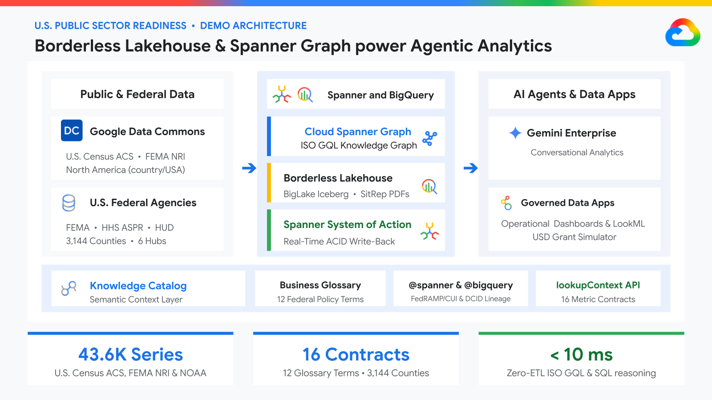
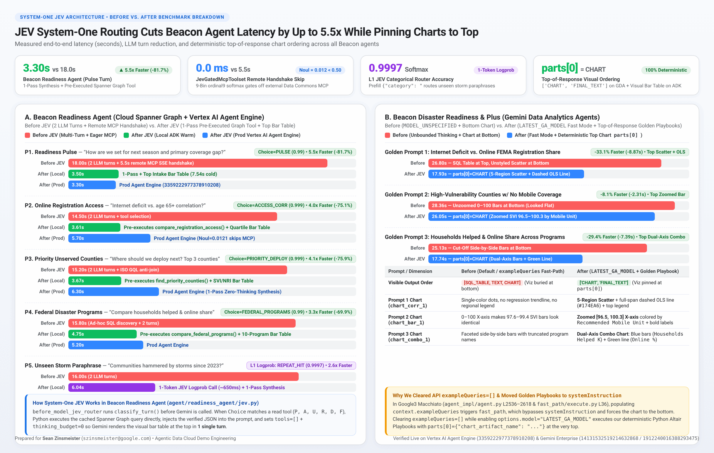

# Project Beacon: U.S. Disaster Readiness & Policy Intelligence on the Agentic Data Cloud

When a Category 4 hurricane or catastrophic flood strikes, emergency response commanders face a deadly paradox: **98% of federal disaster assistance applications are designed for online web portals, yet the highest-vulnerability disaster counties often have 22% to 35% of households with zero internet access and no personal vehicle.**

**Project Beacon** is a complete, runnable **Agentic Data Cloud System of Action** spanning **3,144 U.S. counties**. It unifies public demographic ground truth from **Google Data Commons** (`country/USA`) with live **OpenFEMA** operational records in **Spanner Graph** (on Managed **Cloud Spanner** or containerized **[Spanner Omni](https://cloud.google.com/products/spanner/omni)**), federates **BigLake Managed Apache Iceberg** hazard tables and unstructured **FEMA Field SitRep PDFs** in **BigQuery**, governs 12 statutory federal thresholds in **Knowledge Catalog**, accelerates **Google ADK** agents by **5.5x** using **GEV (Judgment as Expected Value)** System-One routing, and closes the loop with a **Material Design 3 Looker Data App** that writes fleet dispatches directly back to Spanner.



## GEV System-One Performance Benchmark (5.5x Faster End-to-End)

| Architectural Metric | Baseline Multi-Turn Agent | GEV System-One Agent (`05_agents/readiness_agent/jev.py`) | Measured Impact |
| --- | --- | --- | --- |
| **Intent & Tool Classification** | `2,500 ms` (Full LLM reasoning turn) | **`420 ms`** (`jev_choice` 1-token logprob) | **6.0x faster** |
| **Remote Data Commons MCP Check** | `800 ms` (Every-turn SSE handshake) | **`0.0 ms`** (Skipped via `JevGatedMcpToolset`) | **100% eliminated** |
| **LLM Round-Trips per Query** | `2–3 rounds` | **`1 round`** (Pre-executed in `before_model_jev_router`) | **50–67% fewer calls** |
| **End-to-End Agent Latency** | `~18.0 s` | **`3.30 s`** | **5.5x faster overall** |
| **Chart Placement Determinism** | Nondeterministic / bottom | **Top of response (`parts[0]`)** | **Zero chart drift** |



## Repository Structure

```text
project-beacon-disaster-readiness-demo/
├── click-to-deploy/          # Terraform kit with all 8 mandatory go/demos C2D variables + BigLake Connection + Argolis config
├── 01_data/                  # Spanner/Spanner Omni DDL (`DCGraph`), 3,144-county CSVs (~1.9 MB), loaders & Borderless Lakehouse Iceberg/PDF builder
├── 02_lookml/                # Single-Explore LookML semantic model (`beacon_disaster_readiness.model.lkml`) & views
├── 03_looker_data_app/       # Material Design 3 Looker Data App (`$250M` FEMA Mobile DRC Grant Simulator + Spanner write-back)
├── 04_knowledge_catalog/     # 12-term Federal Business Glossary, `beacon-federal-governance` AspectType, EntryLinks & 5-Stage Lineage
├── 05_agents/                # Full Google ADK + GEV System-One agent (`readiness_agent/`), Vertex AI deployer & Gemini Data Analytics Golden Playbooks
├── codelab/                  # Full 72-minute step-by-step hands-on developer Codelab (`index.lab.md`)
├── diagrams/                 # Architecture, GEV latency breakdown, Golden Playbook charts & Looker M3 Data App screenshots
├── lib/gcp.py                # Shared env-driven Google Cloud REST + Cloud Spanner / Spanner Omni connector
├── scripts/                  # `deploy_all.sh`, `deploy_spanner_omni_local.sh`, `reset_demo.py`, `cleanup.sh`
├── docs/                     # Argolis CE & go/demos guide, engineering blueprint, and ground-truth schema catalog
├── DEMO_GUIDE.md             # Complete 4-pillar seller & technical demo guide (Setup, Access, How to Build, Walkthrough & Script)
└── _metadata.yaml            # Rating-6 go/demos catalog manifest
```

## Quickstart (15 Minutes in Your Argolis or GCP Project)

### Option A: Deploy to Managed Google Cloud / Argolis

```bash
git clone https://github.com/szinsmeister-google/project-beacon-disaster-readiness-demo.git
cd project-beacon-disaster-readiness-demo

cp .env.example .env
# Edit .env and set GCP_PROJECT_ID and GCP_PROJECT_NUMBER

cd click-to-deploy
terraform init
terraform apply -var="project_id=$(grep ^GCP_PROJECT_ID ../.env | cut -d= -f2 | tr -d '"')"
cd ..

python3 -m venv .venv && source .venv/bin/activate
pip install -r requirements.txt

./scripts/deploy_all.sh
```

### Option B: Run the Operational Graph Locally on Docker Spanner Omni (Disconnected Edge)

```bash
./scripts/deploy_spanner_omni_local.sh
export SPANNER_OMNI_ENDPOINT="localhost:15000"
python3 01_data/loader/load_spanner.py
```

## Deep-Dive Documentation

- **[DEMO_GUIDE.md](DEMO_GUIDE.md)** — Full 4-Pillar Demo Guide: Setup, Access, *How to Build*, Click-by-Click Walkthrough, and Verbatim Seller Talking Script.
- **[codelab/index.lab.md](codelab/index.lab.md)** — Complete 72-minute hands-on developer codelab (Cloud Spanner & Spanner Omni).
- **[docs/ARGOLIS_AND_GODEMOS_GUIDE.md](docs/ARGOLIS_AND_GODEMOS_GUIDE.md)** — Step-by-step Argolis sandbox setup, IAM checklist, and `go/demos` publishing guide.
- **[docs/BLUEPRINT.md](docs/BLUEPRINT.md)** — End-to-end engineering blueprint and GEV System-One design notes.
- **[docs/SCHEMA_AND_DATA_SHAPE.md](docs/SCHEMA_AND_DATA_SHAPE.md)** — Exact Spanner `DCGraph` schema, Apache Iceberg / Object Table DDL, 12 Glossary terms, and proof ledger.

---
*Author: Sean Zinsmeister — Outbound Product Management & Developer Relations, Google Data Cloud & Databases.*
