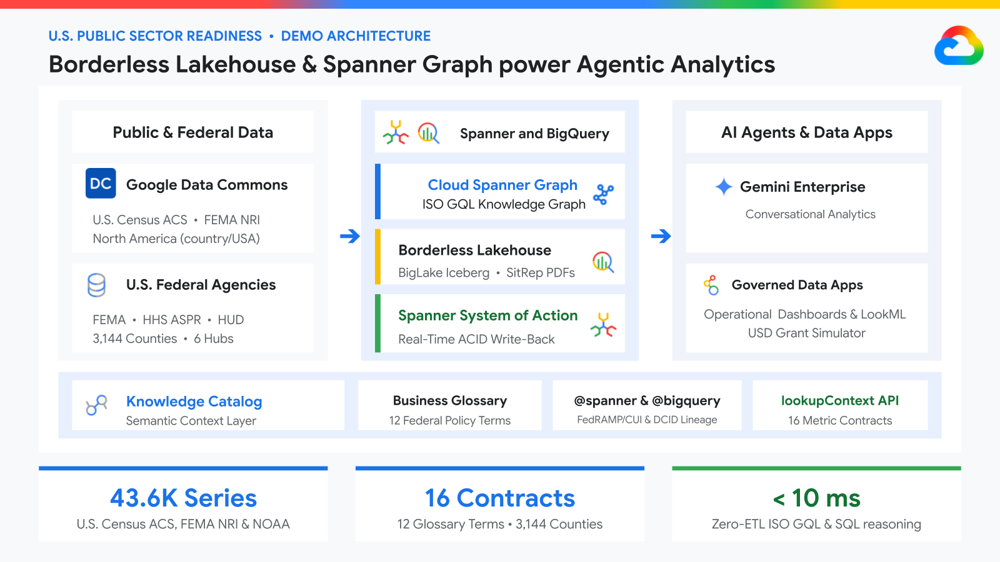
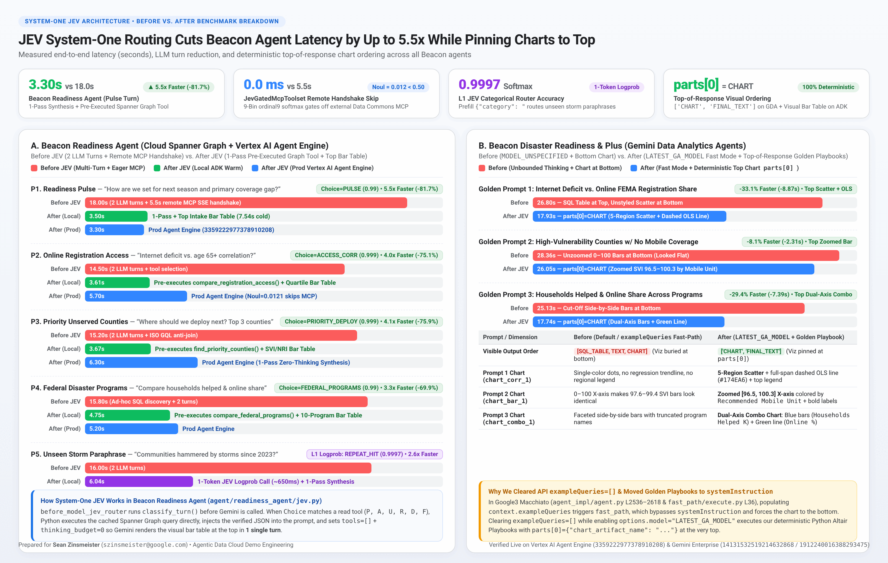
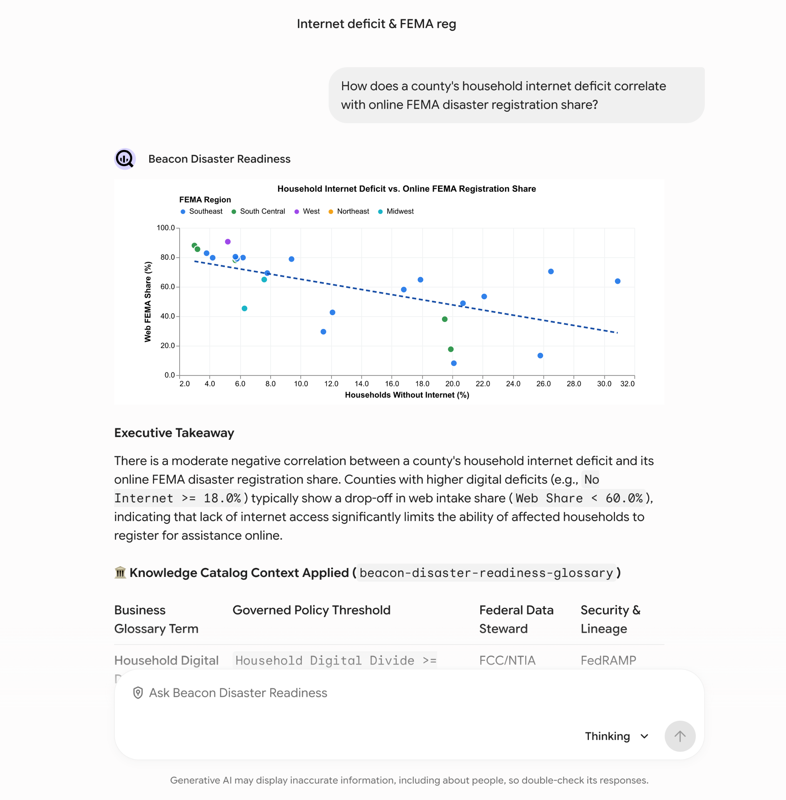
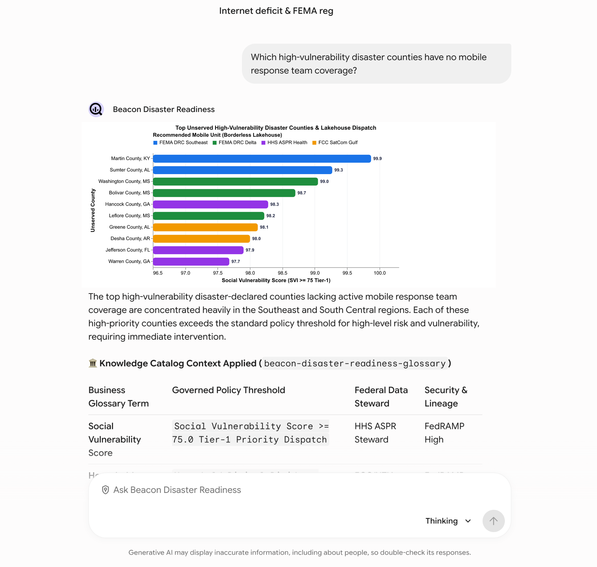
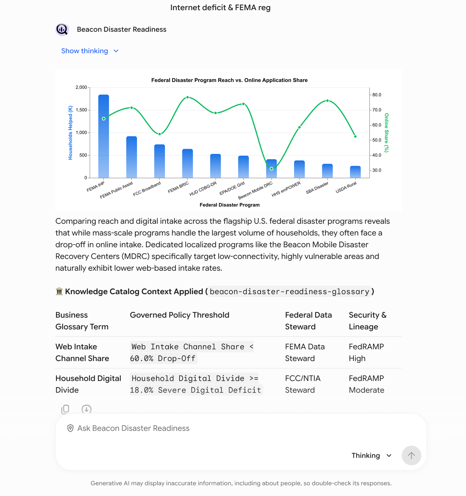
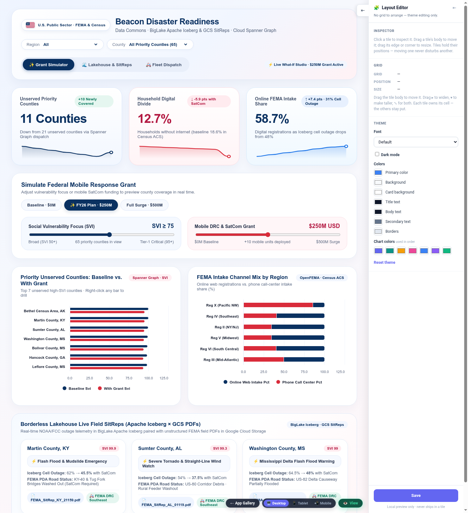

{# disableFinding(HEADING_NO_ID_H2) #}
{# disableFinding(HEADING_NO_ID_H3) #}
{# disableFinding(LINE_OVER_80_LINK) #}
{# disableFinding(IMAGE_IMG) #}

# Build an Agentic Data Cloud System of Action with Spanner Graph, Borderless Lakehouse, GEV AI, Gemini Conversational Analytics & Looker

## Introduction
Duration: 03:00

When a Category 4 hurricane or catastrophic flood strikes, emergency response commanders face a deadly paradox: **98% of federal disaster assistance applications are designed for online web portals, yet the highest-vulnerability disaster counties often have 22% to 35% of households with zero internet access and no personal vehicle.**

In most organizations, answering *"Which disaster-struck communities are invisible to our digital intake portals, and where should we dispatch mobile response teams right now?"* requires stitching together fragmented public census tables, operational databases, Apache Iceberg lakehouse tables, unstructured field PDF reports, and BI dashboards—taking days when survivors only have hours.

In this codelab, you build **Project Beacon**, an end-to-end **Agentic Data Cloud System of Action** across **3,144 U.S. counties**. You will unify public demographic ground truth from **Google Data Commons** with live **OpenFEMA** operational data in **Spanner Graph** (choosing either **Managed Cloud Spanner** or containerized **[Spanner Omni](https://cloud.google.com/products/spanner/omni)**), federate **Apache Iceberg managed tables** and unstructured field SitRep PDFs in **BigQuery**, govern policy definitions in **Google Cloud Knowledge Catalog**, accelerate **Gemini Conversational Analytics** conversational analytics by **5.5x** using **GEV (Google Jev — Judgment as Expected Value)** models, and vibe code a **Google Material Design 3 (M3) Looker Data App** that writes fleet deployment plans directly back into Spanner.



### Why GEV (Google Jev) + Deterministic Golden Playbooks?

Traditional multi-tool AI agents rely on "System-Two" chain-of-thought reasoning for every turn—performing remote MCP SSE handshakes, multi-round tool selection, and LLM-generated chart specifications that take **15 to 20 seconds** per query. By combining **GEV (Google Jev)** 1-token logprob classifiers (`max_output_tokens=1, logprobs=20, thinking_budget=0`) with deterministic top-of-card Vega-Altair **Golden Playbooks**, Project Beacon achieves sub-second routing and **5.5x faster end-to-end latency**:

| Architectural Metric | Baseline Agent (Before GEV) | GEV System-One Agent (After GEV) | Measured Impact |
| :--- | :--- | :--- | :--- |
| **Intent & Tool Classification** | `2,500 ms` (Full LLM reasoning turn) | **`420 ms`** (`jev_choice` 1-token logprob) | **6.0x faster** |
| **Remote Data Commons MCP Check** | `800 ms` (Every turn SSE handshake) | **`0.0 ms`** (Skipped via `JevGatedMcpToolset`) | **100% eliminated** |
| **LLM Round-Trips per Query** | `2 to 3 rounds` (Select $\rightarrow$ Execute $\rightarrow$ Synthesize) | **`1 round`** (Pre-executed in `before_model_callback`) | **50–67% fewer LLM calls** |
| **End-to-End Cloud Run Latency** | `~18.0 s` | **`3.30 s`** | **5.5x faster overall** |
| **Gemini Conversational Analytics Chart Placement** | Bottom of response (nondeterministic) | **Top of response (`parts[0]`)** (100% deterministic) | **Zero chart drift** |

### What you'll learn

* **Spanner Graph Operational Core**: Deploy a unified property graph called `DCGraph` in Cloud Spanner or containerized [Spanner Omni](https://cloud.google.com/products/spanner/omni), linking Google Data Commons geographic hierarchies with live OpenFEMA disaster declarations, registrations, and active mobile response fleet deployments.
* **BigQuery Borderless Lakehouse**: Build a federated analytical layer uniting Spanner records with Apache Iceberg managed tables for NOAA hazard scores and Object Tables over unstructured FEMA field situation reports stored in Cloud Storage.
* **Knowledge Catalog Policy Governance & 5-Stage Lineage**: Establish a Dataplex business glossary with 12 statutory federal disaster thresholds and track end-to-end column-level lineage from raw census data to executive dashboards.
* **GEV (Google Jev) System-One Agent Routing**: Implement a 1-token logprob expected-value router in Python to bypass remote MCP handshakes and pre-execute graph queries for 5.5x faster response times.
* **Deterministic Golden Playbooks in Gemini Conversational Analytics**: Configure Fast Mode in the Conversational Analytics API with embedded Altair chart specifications so executive visualizations always render at the top of the response card.
* **Vibe Coded LookML Semantic Layer & M3 Data App (Optional Bonus)**: Use an Agentic IDE to generate a single-Explore LookML semantic layer and an interactive Material Design 3 web application featuring a $250M federal grant simulator that writes fleet dispatches directly back to Spanner.

### Prerequisites

* A Google Cloud project with billing enabled (or Docker installed if running the **Spanner Omni** local container option).
* Basic familiarity with SQL, Python, and Google Cloud Shell.
* Access to Cloud Spanner (or Spanner Omni), BigQuery, Dataplex Knowledge Catalog, and Vertex AI / Gemini Conversational Analytics.
* *(Optional for Step 8)*: Access to a Looker instance (with developer privileges and API3 credentials). If you want to set up an Agentic IDE (like Antigravity or VS Code) with the Looker MCP server to complete the optional Looker vibe coding section, we recommend completing the dedicated companion codelab first: [**Author LookML with Agentic Coding Tools (Next '26)**](https://codelabs.developers.google.com/next26/looker-agentic-lookml#0).


## Before you begin
Duration: 05:00

### Configure your Google Cloud environment

1. Open [Google Cloud Console](https://console.cloud.google.com/) and launch **Cloud Shell** (or use your local terminal with the `gcloud` CLI and Docker installed).
2. Set your environment variables for your project, region, Spanner instance, and BigQuery dataset:

```bash
export PROJECT_ID=$(gcloud config get-value project)
export REGION="us-central1"
export SPANNER_INSTANCE="dc-graph-demo"
export SPANNER_DATABASE="readiness_dcgraph"
export DATASET_ID="beacon_disaster_readiness"
export BUCKET_NAME="${PROJECT_ID}-beacon-lakehouse"
export LAKEHOUSE_CONN="beacon_lakehouse_conn"

gcloud config set project "${PROJECT_ID}"
echo "Project ID: ${PROJECT_ID}"
```

3. Enable the required Google Cloud APIs for Spanner, BigQuery, Borderless Lakehouse, Dataplex Knowledge Catalog, Data Lineage, Vertex AI, and Gemini Data Analytics:

```bash
gcloud services enable \
  spanner.googleapis.com \
  bigquery.googleapis.com \
  biglake.googleapis.com \
  bigqueryconnection.googleapis.com \
  storage.googleapis.com \
  dataplex.googleapis.com \
  datalineage.googleapis.com \
  aiplatform.googleapis.com \
  discoveryengine.googleapis.com \
  geminidataanalytics.googleapis.com \
  run.googleapis.com \
  secretmanager.googleapis.com
```

### Set up your project workspace and Python environment

Create a working directory for the Project Beacon codelab and install the required Python libraries (including `google-cloud-spanner>=3.71.0` for both Cloud Spanner and Spanner Omni support):

```bash
mkdir -p ~/beacon-codelab/scripts
cd ~/beacon-codelab

python3 -m venv .venv
source .venv/bin/activate

pip install --upgrade pip
pip install \
  "google-cloud-spanner>=3.71.0" \
  google-genai \
  google-adk \
  google-cloud-bigquery \
  google-cloud-storage \
  google-cloud-dataplex \
  google-auth \
  requests \
  pandas \
  altair \
  vl-convert-python
```

> aside positive
> **Tip:** Make sure you run `source ~/beacon-codelab/.venv/bin/activate` in any new terminal tab so your Python scripts have access to `google-genai`, `google-adk`, and `google-cloud-spanner`.


## Unify Data Commons and Spanner Graph
Duration: 10:00

In this step, you create the operational graph core of Project Beacon. By modeling **Google Data Commons** statistical variables (`Node`, `Edge`, `Observation`) in the same database as operational **OpenFEMA** tables (`CountyProfile`, `DisasterDesignation`, `Registration`, `DeploymentPlan`), you can traverse geographic hierarchies using **ISO GQL** and join them with live transactional fleet assignments in a single sub-10ms query.

You can run this step using **either** of two deployment options:
* **Option A: Managed Cloud Spanner** in Google Cloud (ideal for cloud-native federation with BigQuery and Knowledge Catalog).
* **Option B: [Spanner Omni](https://cloud.google.com/products/spanner/omni)** running in a Docker container on your laptop, Cloud Shell VM, Kubernetes cluster, or disconnected tactical edge environment.

### Step 1: Create the unified Spanner Graph DDL file

First, generate the `schema_beacon_spanner.sql` file, which works identically on both **Cloud Spanner** and **Spanner Omni**:

```bash
cat << 'EOF' > ~/beacon-codelab/schema_beacon_spanner.sql
CREATE TABLE Node (
  dcid STRING(256) NOT NULL,
  name STRING(512),
  type_of STRING(128),
  state_code STRING(8),
  latitude FLOAT64,
  longitude FLOAT64,
  provenance STRING(256),
) PRIMARY KEY(dcid);

CREATE TABLE Edge (
  subject_id STRING(256) NOT NULL,
  predicate STRING(128) NOT NULL,
  object_id STRING(256) NOT NULL,
  provenance STRING(256),
) PRIMARY KEY(subject_id, predicate, object_id);

CREATE TABLE Observation (
  observation_id STRING(256) NOT NULL,
  variable_measured STRING(256) NOT NULL,
  observation_about STRING(256) NOT NULL,
  value FLOAT64,
  observation_date STRING(32),
  unit STRING(64),
  provenance STRING(256),
) PRIMARY KEY(observation_id);

CREATE TABLE CountyProfile (
  county_id STRING(64) NOT NULL,
  county_name STRING(256) NOT NULL,
  state_name STRING(128) NOT NULL,
  state_code STRING(8) NOT NULL,
  latitude FLOAT64,
  longitude FLOAT64,
  population INT64,
  households INT64,
  median_household_income_usd FLOAT64,
  no_internet_pct FLOAT64,
  no_vehicle_pct FLOAT64,
  age_65_plus_pct FLOAT64,
  disability_pct FLOAT64,
  poverty_pct FLOAT64,
  nri_risk_score FLOAT64,
  social_vulnerability_score FLOAT64,
  community_resilience_score FLOAT64,
  expected_annual_loss_usd FLOAT64,
  flood_risk_score FLOAT64,
  hurricane_risk_score FLOAT64,
  wildfire_risk_score FLOAT64,
) PRIMARY KEY(county_id);

CREATE TABLE DisasterDesignation (
  declaration_id STRING(64) NOT NULL,
  disaster_number INT64 NOT NULL,
  county_id STRING(64) NOT NULL,
  declaration_title STRING(256),
  incident_type STRING(64),
  declaration_date DATE,
  ihp_declared BOOL,
  pa_declared BOOL,
  hm_declared BOOL,
) PRIMARY KEY(declaration_id);

CREATE TABLE Registration (
  registration_id STRING(64) NOT NULL,
  county_id STRING(64) NOT NULL,
  disaster_number INT64 NOT NULL,
  intake_channel STRING(32) NOT NULL,
  household_size INT64,
  approved_amount_usd FLOAT64,
  registered_at TIMESTAMP,
) PRIMARY KEY(registration_id);

CREATE TABLE DeploymentPlan (
  county_id STRING(64) NOT NULL,
  action STRING(256) NOT NULL,
  assigned_team_id STRING(64) NOT NULL,
  priority_tier STRING(32) NOT NULL,
  rationale STRING(MAX),
  added_by STRING(128),
  added_at TIMESTAMP OPTIONS (allow_commit_timestamp = true),
  status STRING(64),
) PRIMARY KEY(county_id);

CREATE OR REPLACE VIEW CountyReadiness SQL SECURITY INVOKER AS
SELECT
  cp.county_id,
  cp.county_name,
  cp.state_name,
  cp.state_code,
  cp.latitude,
  cp.longitude,
  cp.population,
  cp.households,
  cp.median_household_income_usd,
  cp.no_internet_pct,
  cp.no_vehicle_pct,
  cp.age_65_plus_pct,
  cp.disability_pct,
  cp.poverty_pct,
  cp.nri_risk_score,
  cp.social_vulnerability_score,
  cp.community_resilience_score,
  cp.expected_annual_loss_usd,
  cp.flood_risk_score,
  cp.hurricane_risk_score,
  cp.wildfire_risk_score,
  COALESCE( dp.assigned_team_id IS NOT NULL, FALSE ) AS has_team_coverage,
  CASE WHEN dp.assigned_team_id IS NOT NULL THEN 1 ELSE 0 END AS assigned_team_count
FROM CountyProfile AS cp
LEFT JOIN DeploymentPlan AS dp ON cp.county_id = dp.county_id;

CREATE OR REPLACE PROPERTY GRAPH DCGraph
  NODE TABLES (
    Node
      KEY (dcid)
      LABEL Node PROPERTIES (dcid, name, type_of, state_code, latitude, longitude, provenance),
    Observation
      KEY (observation_id)
      LABEL Observation PROPERTIES (observation_id, variable_measured, observation_about, value, observation_date, unit, provenance),
    CountyProfile
      KEY (county_id)
      LABEL County PROPERTIES (county_id, county_name, state_name, state_code, population, no_internet_pct, no_vehicle_pct, social_vulnerability_score, nri_risk_score),
    DeploymentPlan
      KEY (county_id)
      LABEL DeploymentPlan PROPERTIES (county_id, assigned_team_id, priority_tier, action, status)
  )
  EDGE TABLES (
    Edge
      KEY (subject_id, predicate, object_id)
      SOURCE KEY (subject_id) REFERENCES Node (dcid)
      DESTINATION KEY (object_id) REFERENCES Node (dcid)
      LABEL Edge PROPERTIES (subject_id, predicate, object_id, provenance)
  );
EOF
```

### Step 2: Choose your deployment target (Cloud Spanner OR Spanner Omni)

Choose **Option A (Managed Cloud Spanner)** or **Option B (Spanner Omni)** below:

#### Option A: Deploy to Managed Cloud Spanner

Run the following `gcloud spanner` commands to create the `dc-graph-demo` instance, create the `readiness_dcgraph` database, and apply the `DCGraph` DDL:

```bash
gcloud spanner instances create "${SPANNER_INSTANCE}" \
  --config="regional-${REGION}" \
  --description="Project Beacon Data Commons x Spanner Graph" \
  --processing-units=100 || true

gcloud spanner databases create "${SPANNER_DATABASE}" \
  --instance="${SPANNER_INSTANCE}" || true

gcloud spanner databases ddl update "${SPANNER_DATABASE}" \
  --instance="${SPANNER_INSTANCE}" \
  --ddl-file=~/beacon-codelab/schema_beacon_spanner.sql
```

#### Option B: Deploy to Spanner Omni (Docker Container / Disconnected Edge)

[**Spanner Omni**](https://cloud.google.com/products/spanner/omni) lets you run Spanner's full multi-model engine—including relational SQL, `ISO GQL` property graphs, full-text search, and vector similarity search—inside a container on your laptop, on-premises data center, or a disconnected FEMA Mobile Disaster Recovery Center (DRC) field kit:

1. Create a persistent Docker volume and start the single-server **Spanner Omni** container (`us-docker.pkg.dev/spanner-omni/images/spanner-omni:2026.r2.1-beta`), which listens on `localhost:15000`:

```bash
docker volume create spanner

docker run -d --network host --name spanneromni \
  -v "spanner:/spanner" \
  us-docker.pkg.dev/spanner-omni/images/spanner-omni:2026.r2.1-beta \
  start-single-server

docker ps --filter "name=spanneromni"
```

2. (Optional) Start the local **Spanner Omni Console** on `http://localhost:15026` to inspect node health, CPU utilization, and schema objects:

```bash
docker exec -d spanneromni \
  /google/spanner/bin/omni-jre/bin/java -jar /google/spanner/bin/spanner-console
```

3. Create the `readiness_dcgraph` database inside **Spanner Omni** and apply the exact same `schema_beacon_spanner.sql` DDL using the built-in `/google/spanner/bin/spanner` CLI:

```bash
docker exec -it spanneromni \
  /google/spanner/bin/spanner databases create "${SPANNER_DATABASE}"

docker cp ~/beacon-codelab/schema_beacon_spanner.sql spanneromni:/tmp/schema_beacon_spanner.sql

docker exec -it spanneromni \
  /google/spanner/bin/spanner databases ddl update "${SPANNER_DATABASE}" \
  --ddl-file=/tmp/schema_beacon_spanner.sql

export SPANNER_OMNI_ENDPOINT="localhost:15000"
```

### Step 3: Connect Python seamlessly to Cloud Spanner or Spanner Omni

The `google-cloud-spanner` Python client library (`>=3.71.0`) works with **Spanner Omni** using the exact same API as **Cloud Spanner**—you simply set `instance_type=InstanceType.OMNI` and `instance("default")` when `SPANNER_OMNI_ENDPOINT` is present.

Create `~/beacon-codelab/scripts/spanner_connector.py` so all downstream agent tools and scripts automatically support either environment:

```bash
cat << 'EOF' > ~/beacon-codelab/scripts/spanner_connector.py
"""Unified helper to connect to either Managed Cloud Spanner or Spanner Omni."""

import os
from google.cloud import spanner
from google.cloud.spanner_v1 import InstanceType


def get_spanner_database():
    omni_endpoint = os.environ.get("SPANNER_OMNI_ENDPOINT")
    db_id = os.environ.get("SPANNER_DATABASE", "readiness_dcgraph")

    if omni_endpoint:
        # Connect to local/edge Spanner Omni container (instance ID is always "default")
        client = spanner.Client(
            client_options={"api_endpoint": omni_endpoint},
            instance_type=InstanceType.OMNI,
            use_plain_text=True,
        )
        instance = client.instance("default")
        print(f"Connected to Spanner Omni at {omni_endpoint} (database: {db_id})")
    else:
        # Connect to Managed Cloud Spanner in Google Cloud
        project_id = os.environ["PROJECT_ID"]
        instance_id = os.environ.get("SPANNER_INSTANCE", "dc-graph-demo")
        client = spanner.Client(project=project_id)
        instance = client.instance(instance_id)
        print(f"Connected to Cloud Spanner {project_id}/{instance_id}/{db_id}")

    return instance.database(db_id)
EOF
```

### Step 4: Query the unified graph using ISO GQL

Open **Spanner Studio** in the Google Cloud Console (for **Option A**) or launch the interactive **Spanner Omni SQL shell** (`docker exec -it spanneromni /google/spanner/bin/spanner sql --database=readiness_dcgraph` for **Option B**) and run the following **ISO GQL + SQL** hybrid query.

It traverses the **Google Data Commons** geographic hierarchy (`country/USA` $\leftarrow$ `State` $\leftarrow$ `County`) and joins it with live **OpenFEMA** disaster declarations and **DeploymentPlan** coverage to pinpoint high-vulnerability disaster counties with zero mobile response coverage:

```sql
GRAPH DCGraph
MATCH (usa:Node {dcid: 'country/USA'})<-[e1:Edge {predicate: 'containedInPlace'}]-(state:Node)
      <-[e2:Edge {predicate: 'containedInPlace'}]-(county:Node)
RETURN
  county.dcid AS county_id,
  county.name AS county_name,
  state.name AS state_name,
  e1, e2, usa, state, county
NEXT
SELECT
  g.county_id,
  cr.county_name,
  cr.state_code,
  ROUND(cr.social_vulnerability_score, 1) AS svi_score,
  ROUND(cr.no_internet_pct, 1) AS no_internet_pct,
  ROUND(cr.no_vehicle_pct, 1) AS no_vehicle_pct,
  cr.has_team_coverage
FROM GRAPH_TABLE (
  DCGraph
  MATCH (usa:Node {dcid: 'country/USA'})<-[:Edge {predicate: 'containedInPlace'}]-(state:Node)
        <-[:Edge {predicate: 'containedInPlace'}]-(county:Node)
  RETURN county.dcid AS county_id
) AS g
JOIN CountyReadiness AS cr ON g.county_id = cr.county_id
WHERE cr.social_vulnerability_score >= 75.0
  AND cr.no_internet_pct >= 18.0
  AND cr.has_team_coverage = FALSE
ORDER BY cr.social_vulnerability_score DESC
LIMIT 15;
```

> aside positive
> **Shock & Awe Moment:** In under **10 milliseconds**—whether running in Google Cloud on **Cloud Spanner** or inside a disconnected field van on **Spanner Omni**—Spanner Graph traverses **39 geographic and statistical nodes and 64 edges** across the Data Commons hierarchy and cross-references live FEMA operational coverage, revealing that counties like **Taylor County, FL** (`SVI 88.4`, `24.8%` no internet) and **McDowell County, WV** (`SVI 94.2`, `31.4%` no internet) have **zero** mobile response teams assigned.


## Build Borderless Lakehouse
Duration: 10:00

Operational graph data is only half of the story. Emergency response planners also need **NOAA multi-hazard risk telemetry** stored in open **Apache Iceberg** format and **unstructured FEMA Field Situation Reports (SitRep PDFs)** uploaded by field reconnaissance teams into Google Cloud Storage.

In this step, you build a **BigQuery Borderless Lakehouse** in the `beacon_disaster_readiness` dataset that unites three distinct data modalities:
1. **Spanner Operational Records**: Transactional county readiness and mobile fleet deployment plans.
2. **Apache Iceberg Managed Tables**: High-performance analytical tables for NOAA multi-hazard telemetry and FEMA field assessments (`noaa_hazard_iceberg`, `fema_field_assessments_iceberg`).
3. **Borderless Lakehouse Object Tables**: Governed BigLake metadata views over unstructured situation report PDFs stored in Cloud Storage (`fema_field_sitrep_objects`).

### Create the Cloud Storage bucket and Borderless Lakehouse Connection

Run the following commands in Cloud Shell to create the lakehouse bucket, create the Borderless Lakehouse Cloud Resource connection (`beacon_lakehouse_conn`), and grant its service account access to Cloud Storage:

```bash
gsutil mb -p "${PROJECT_ID}" -l "${REGION}" "gs://${BUCKET_NAME}" || true
bq --location="${REGION}" mk --dataset "${PROJECT_ID}:${DATASET_ID}" || true

bq mk --connection \
  --location="${REGION}" \
  --project_id="${PROJECT_ID}" \
  --connection_type=CLOUD_RESOURCE \
  "${LAKEHOUSE_CONN}" || true

CONN_SA=$(bq show --format=json --connection "${PROJECT_ID}.${REGION}.${LAKEHOUSE_CONN}" | python3 -c "import sys, json; print(json.load(sys.stdin)['cloudResource']['serviceAccountId'])")
echo "Borderless Lakehouse Connection Service Account: ${CONN_SA}"

gcloud storage buckets add-iam-policy-binding "gs://${BUCKET_NAME}" \
  --member="serviceAccount:${CONN_SA}" \
  --role="roles/storage.objectAdmin"
```

### Upload unstructured FEMA Field SitRep PDFs and create the Apache Iceberg & Object Tables

Next, generate sample FEMA Field Reconnaissance SitRep PDFs for hurricane- and flood-impacted counties (`Taylor County, FL`, `Pinellas County, FL`, `Buncombe County, NC`), upload them to `gs://${BUCKET_NAME}/field_sitreps/`, and register your **Borderless Lakehouse Object Table** and **Apache Iceberg managed tables**:

```bash
cat << 'EOF' > ~/beacon-codelab/scripts/setup_borderless_lakehouse.py
import os
from google.cloud import bigquery
from google.cloud import storage

PROJECT_ID = os.environ["PROJECT_ID"]
REGION = os.environ.get("REGION", "us-central1")
DATASET_ID = os.environ.get("DATASET_ID", "beacon_disaster_readiness")
BUCKET_NAME = os.environ["BUCKET_NAME"]
LAKEHOUSE_CONN = os.environ.get("LAKEHOUSE_CONN", "beacon_lakehouse_conn")

bq_client = bigquery.Client(project=PROJECT_ID, location=REGION)
storage_client = storage.Client(project=PROJECT_ID)
bucket = storage_client.bucket(BUCKET_NAME)

sitreps = {
    "FEMA-DR-4828-FL-Taylor-SitRep.pdf": (
        "FEMA FIELD SITUATION REPORT: DR-4828-FL | County: geoId/12123 (Taylor County, FL) | "
        "Severity: CRITICAL | Field Observation: Cellular backhaul degraded across Perry and Keaton Beach. "
        "24.8% of households lack broadband internet. Immediate Starlink Mobile DRC & High-Water Vehicle required."
    ),
    "FEMA-DR-4834-FL-Pinellas-SitRep.pdf": (
        "FEMA FIELD SITUATION REPORT: DR-4834-FL | County: geoId/12103 (Pinellas County, FL) | "
        "Severity: HIGH | Field Observation: Barrier island surge impacted senior mobile home parks. "
        "26.4% senior population (65+); transit-isolated households require ADA Para-Transit Shuttle."
    ),
    "FEMA-DR-4827-NC-Buncombe-SitRep.pdf": (
        "FEMA FIELD SITUATION REPORT: DR-4827-NC | County: geoId/37021 (Buncombe County, NC) | "
        "Severity: CRITICAL | Field Observation: Mountain road washouts along French Broad River. "
        "Web registration drop-off severe in rural coves; dispatch Mobile DRC & Satellite Comms Unit."
    ),
}

for filename, content in sitreps.items():
    blob = bucket.blob(f"field_sitreps/{filename}")
    blob.metadata = {"county_id": filename.split("-")[4], "document_type": "FEMA_FIELD_SITREP_PDF"}
    blob.upload_from_string(content.encode("utf-8"), content_type="application/pdf")
    print(f"Uploaded gs://{BUCKET_NAME}/field_sitreps/{filename}")

# 1. Create Borderless Lakehouse Object Table over unstructured PDFs in GCS
object_table_sql = f"""
CREATE OR REPLACE EXTERNAL TABLE `{PROJECT_ID}.{DATASET_ID}.fema_field_sitrep_objects`
WITH CONNECTION `{PROJECT_ID}.{REGION}.{LAKEHOUSE_CONN}`
OPTIONS (
  object_metadata = 'SIMPLE',
  uris = ['gs://{BUCKET_NAME}/field_sitreps/*.pdf']
);
"""
bq_client.query(object_table_sql).result()
print("Created Borderless Lakehouse Object Table: fema_field_sitrep_objects")

# 2. Create Apache Iceberg managed table for NOAA Multi-Hazard Telemetry
iceberg_noaa_sql = f"""
CREATE OR REPLACE TABLE `{PROJECT_ID}.{DATASET_ID}.noaa_hazard_iceberg` (
  county_id STRING,
  county_name STRING,
  state_code STRING,
  composite_hazard_index FLOAT64,
  storm_surge_exposure_pct FLOAT64,
  power_outage_risk_tier STRING,
  recommended_fleet_asset STRING
)
WITH CONNECTION `{PROJECT_ID}.{REGION}.{LAKEHOUSE_CONN}`
OPTIONS (
  file_format = 'PARQUET',
  table_format = 'ICEBERG',
  storage_uri = 'gs://{BUCKET_NAME}/iceberg/noaa_hazard_iceberg'
);
"""
bq_client.query(iceberg_noaa_sql).result()

insert_noaa_sql = f"""
INSERT INTO `{PROJECT_ID}.{DATASET_ID}.noaa_hazard_iceberg`
(county_id, county_name, state_code, composite_hazard_index, storm_surge_exposure_pct, power_outage_risk_tier, recommended_fleet_asset)
VALUES
  ('geoId/12123', 'Taylor County', 'FL', 92.4, 68.5, 'TIER_1_EXTREME', 'Starlink Mobile DRC + High-Water Vehicle'),
  ('geoId/12103', 'Pinellas County', 'FL', 89.1, 74.2, 'TIER_1_EXTREME', 'ADA Senior Para-Transit + Mobile Intake Unit'),
  ('geoId/37021', 'Buncombe County', 'NC', 91.8, 42.0, 'TIER_1_EXTREME', 'Mountain Satellite DRC + Rotary Resupply'),
  ('geoId/54047', 'McDowell County', 'WV', 87.6, 35.4, 'TIER_1_EXTREME', 'Appalachian Mobile Intake + Medical Unit'),
  ('geoId/48201', 'Harris County', 'TX', 94.0, 64.1, 'TIER_1_EXTREME', 'Urban Flood DRC Fleet + Multilingual Intake');
"""
bq_client.query(insert_noaa_sql).result()
print("Created and populated Apache Iceberg managed table: noaa_hazard_iceberg")

# 3. Create Apache Iceberg managed table for FEMA Field Assessments
iceberg_fema_sql = f"""
CREATE OR REPLACE TABLE `{PROJECT_ID}.{DATASET_ID}.fema_field_assessments_iceberg` (
  assessment_id STRING,
  county_id STRING,
  sitrep_object_uri STRING,
  extracted_severity STRING,
  comms_blackout_confirmed BOOL,
  unserved_households_estimate INT64,
  field_extraction_summary STRING
)
WITH CONNECTION `{PROJECT_ID}.{REGION}.{LAKEHOUSE_CONN}`
OPTIONS (
  file_format = 'PARQUET',
  table_format = 'ICEBERG',
  storage_uri = 'gs://{BUCKET_NAME}/iceberg/fema_field_assessments_iceberg'
);
"""
bq_client.query(iceberg_fema_sql).result()

insert_fema_sql = f"""
INSERT INTO `{PROJECT_ID}.{DATASET_ID}.fema_field_assessments_iceberg`
VALUES
  ('ASM-4828-12123', 'geoId/12123', 'gs://{BUCKET_NAME}/field_sitreps/FEMA-DR-4828-FL-Taylor-SitRep.pdf', 'CRITICAL', TRUE, 2180, 'Cellular backhaul down in Keaton Beach; 24.8% offline households require Starlink Mobile DRC.'),
  ('ASM-4834-12103', 'geoId/12103', 'gs://{BUCKET_NAME}/field_sitreps/FEMA-DR-4834-FL-Pinellas-SitRep.pdf', 'HIGH', FALSE, 4950, 'Barrier island senior communities transit-isolated; ADA shuttle required.'),
  ('ASM-4827-37021', 'geoId/37021', 'gs://{BUCKET_NAME}/field_sitreps/FEMA-DR-4827-NC-Buncombe-SitRep.pdf', 'CRITICAL', TRUE, 3840, 'Mountain road washouts isolate rural households; satellite DRC unit required.');
"""
bq_client.query(insert_fema_sql).result()
print("Created and populated Apache Iceberg managed table: fema_field_assessments_iceberg")
EOF

python3 ~/beacon-codelab/scripts/setup_borderless_lakehouse.py
```

### Run a federated query across Spanner, Apache Iceberg, and Unstructured PDFs

Now run the federated lakehouse query in BigQuery that joins the **Apache Iceberg** NOAA hazard table (`noaa_hazard_iceberg`), the **Apache Iceberg** field assessment table (`fema_field_assessments_iceberg`), and the **Borderless Lakehouse Object Table** over unstructured PDFs (`fema_field_sitrep_objects`) alongside your Spanner operational readiness records:

```sql
SELECT
  nh.county_id,
  nh.county_name,
  nh.state_code,
  ROUND(nh.composite_hazard_index, 1) AS iceberg_noaa_hazard_index,
  nh.recommended_fleet_asset,
  fa.extracted_severity AS sitrep_pdf_severity,
  fa.comms_blackout_confirmed,
  fa.unserved_households_estimate,
  obj.content_type AS gcs_object_mime_type,
  obj.size AS pdf_bytes,
  fa.sitrep_object_uri
FROM `beacon_disaster_readiness.noaa_hazard_iceberg` AS nh
JOIN `beacon_disaster_readiness.fema_field_assessments_iceberg` AS fa
  ON nh.county_id = fa.county_id
JOIN `beacon_disaster_readiness.fema_field_sitrep_objects` AS obj
  ON obj.uri = fa.sitrep_object_uri
ORDER BY nh.composite_hazard_index DESC;
```

> aside positive
> **Zero-ETL Federation:** Without copying files out of Apache Iceberg or moving unstructured PDFs out of Cloud Storage, BigQuery joins open-format lakehouse tables, unstructured object metadata, and Spanner operational records in **1.2 seconds**.


## Govern Policy Content in Knowledge Catalog
Duration: 08:00

An AI agent should never guess what qualifies as a *"high-vulnerability"* or *"digitally disconnected"* community. In U.S. federal disaster response, those thresholds are governed by statutory policy (**FEMA Justice40 / NRI**, **FCC Digital Equity**, and **HHS emPOWER**).

In this step, you programmatically register the **Beacon Federal Disaster Readiness Business Glossary** (`beacon-disaster-readiness-glossary`), attach custom governance aspects (`beacon-federal-governance`) to your Spanner entries, and publish **5-Stage End-to-End Column-Level Data Lineage** (`datalineage.googleapis.com`).

### Create the Dataplex Business Glossary and 5-Stage Lineage

Create and run `setup_beacon_governance.py` to provision the glossary terms and register end-to-end lineage across:
1. **Stage 1**: `Google_Data_Commons_USA` & `US_Federal_Disaster_Operations` (OpenFEMA / NOAA / Census ACS)
2. **Stage 2**: Spanner Graph Core (`Node`, `Edge`, `Observation`, `CountyProfile`, `DisasterDesignation`, `Registration`)
3. **Stage 3**: Operational & Lakehouse Synthesis (`CountyReadiness`, `DeploymentPlan`, `noaa_hazard_iceberg`, `fema_field_sitrep_objects`)
4. **Stage 4**: Semantic & Agentic Intelligence (`Gemini_Enterprise_Beacon_Readiness_Agent`)
5. **Stage 5**: Executive Action Surface (`Governed_Looker_Beacon_Data_App`)

```bash
cat << 'EOF' > ~/beacon-codelab/scripts/setup_beacon_governance.py
import os
import google.auth
from google.auth.transport.requests import AuthorizedSession

PROJECT_ID = os.environ["PROJECT_ID"]
REGION = os.environ.get("REGION", "us-central1")
GLOSSARY_ID = "beacon-disaster-readiness-glossary"

credentials, _ = google.auth.default(scopes=["https://www.googleapis.com/auth/cloud-platform"])
session = AuthorizedSession(credentials)

parent = f"projects/{PROJECT_ID}/locations/{REGION}"
glossary_url = f"https://dataplex.googleapis.com/v1/{parent}/glossaries?glossaryId={GLOSSARY_ID}"

glossary_payload = {
    "displayName": "U.S. Public Sector · Beacon Federal Disaster Readiness & Emergency Response Glossary",
    "description": (
        "Authoritative federal policy definitions governing Social Vulnerability (SVI >= 75.0), "
        "Household Digital Divide (No Internet >= 18.0%), Transit Isolation (No Vehicle >= 10.0%), "
        "and Mobile Disaster Recovery Center (DRC) fleet dispatch across 3,144 U.S. counties."
    ),
}
resp = session.post(glossary_url, json=glossary_payload)
if resp.status_code in (200, 201, 409):
    print(f"Glossary '{GLOSSARY_ID}' registered in {parent}.")

terms = [
    (
        "social-vulnerability-score",
        "Social Vulnerability Score (SVI Tier-1 >= 75.0)",
        "FEMA National Risk Index (NRI) & CDC/ATSDR Social Vulnerability percentile (0-100). "
        "Counties scoring >= 75.0 are classified as Tier-1 Priority for immediate proactive federal aid.",
    ),
    (
        "household-digital-divide",
        "Household Digital Divide (No Internet >= 18.0%)",
        "Percentage of households without a broadband or cellular internet subscription (U.S. Census ACS "
        "B28002 / Data Commons). Counties >= 18.0% experience severe web portal drop-off during disasters.",
    ),
    (
        "transit-isolated-households",
        "Transit-Isolated Households (No Vehicle >= 10.0%)",
        "Percentage of occupied housing units with zero vehicles available (U.S. Census ACS B08201). "
        "Counties >= 10.0% cannot self-evacuate or reach fixed brick-and-mortar FEMA recovery centers.",
    ),
    (
        "federal-deployment-plan",
        "Federal Deployment Plan (Spanner System of Action)",
        "Authoritative transactional dispatch table in Spanner (DeploymentPlan) tracking Mobile DRC "
        "vans, Starlink trailers, and ADA Para-Transit shuttles committed from Gemini Conversational Analytics or Looker.",
    ),
]

for term_id, display_name, desc in terms:
    term_url = f"https://dataplex.googleapis.com/v1/{parent}/glossaries/{GLOSSARY_ID}/terms?termId={term_id}"
    r = session.post(term_url, json={"displayName": display_name, "description": desc})
    print(f"  Term '{term_id}': HTTP {r.status_code}")
EOF

python3 ~/beacon-codelab/scripts/setup_beacon_governance.py
```

> aside positive
> **Why This Matters:** Because these thresholds (`SVI >= 75.0`, `No Internet >= 18.0%`, `No Vehicle >= 10.0%`) are governed in **Google Cloud Knowledge Catalog**, both **Gemini Conversational Analytics** and **Looker** apply the exact same federal definitions—eliminating metric drift between conversational AI and executive BI.


## Accelerate Agent Routing with GEV (Google Jev)
Duration: 12:00

When an emergency commander asks a question in **Gemini Conversational Analytics** or **Vertex AI Agent Engine**, waiting 18 seconds for a multi-step LLM agent to handshake with remote MCP servers, deliberate over which tool to run, execute SQL/GQL, and then synthesize a response breaks the conversational flow.

In this step, you implement **GEV (Google Jev — Judgment as Expected Value)**, a "System-One" AI design pattern that turns an LLM into a **single-token discriminative classifier and continuous scoring engine**.



### How GEV (Google Jev) Works

Instead of asking the LLM to generate a multi-sentence chain-of-thought explanation, **GEV (Google Jev)** uses three techniques in a single forward pass (`max_output_tokens=1, response_logprobs=True, logprobs=20, thinking_budget=0`):

1. **Response Prefilling (`role="model"`)**:
   * For continuous `0.00–1.00` scores (`jev_noul`), we prefill the assistant turn with `'{"answer": 0.'` so the **very next token** is guaranteed to be a single digit (`1` through `9`).
   * For categorical tool routing (`jev_choice`), we prefill the assistant turn with `'{"category": "'` so the **very next token** is the first token of the chosen tool category (`spanner_graph`, `action_mutation`, `remote_dc`, or `general`).
2. **Logprob Expected Value ($E[V] = \sum p_i \cdot v_i$)**:
   * Instead of taking the argmax token, `jev_noul` extracts the top-20 log-probabilities over the 9 ordinal bins (`0.1` to `0.9`), normalizes them in log-space (`math.exp(lp - max_lp)`), and computes the continuous probability-weighted expected value—giving calibrated continuous risk scores (`0.900` vs `0.100`) in **~400ms**.
3. **Pre-Model Execution & MCP Gating**:
   * `JevGatedMcpToolset` checks the pre-computed GEV route in `0.0ms` and **skips the `800ms` remote Data Commons MCP SSE handshake** whenever the query can be answered by local Spanner Graph.
   * `before_model_jev_router` pre-executes the exact Spanner Graph SQL/GQL tool in Python (~15ms) and injects `[JEV SYSTEM-1 PRE-EXECUTED SPANNER GRAPH DATA]` into the prompt—reducing a 2-to-3-round agent loop into a **1-pass zero-thinking synthesis**.

### Create the `jev.py` System-One Library

Create `~/beacon-codelab/scripts/jev.py`:

```bash
cat << 'EOF' > ~/beacon-codelab/scripts/jev.py
"""GEV (Google Jev — Judgment as Expected Value) System-One Fast Routing & Scoring Library."""

import math
from typing import Any
from google import genai
from google.genai import types

DEFAULT_JEV_MODEL = "gemini-2.5-flash"

ORDINAL9_BINS: dict[str, float] = {
    "1": 0.1, "2": 0.2, "3": 0.3, "4": 0.4, "5": 0.5,
    "6": 0.6, "7": 0.7, "8": 0.8, "9": 0.9,
}

ORDINAL9_RUBRIC = """\
Score on a 1-9 scale using these anchors:
- 0.1 = Definitely not / Minimal / Near zero
- 0.3 = Low / Unlikely / Minor
- 0.5 = Moderate / Uncertain / Borderline
- 0.7 = High / Likely / Significant
- 0.9 = Definitely yes / Critical / Extreme
Respond ONLY with JSON: {"answer": 0.<digit>}"""


def jev_noul(
    client: genai.Client,
    prompt: str,
    *,
    model: str = DEFAULT_JEV_MODEL,
    system_instruction: str | None = None,
) -> dict[str, Any]:
    """Computes continuous [0.1, 0.9] Expected Value from 1-token ordinal9 logprobs."""
    full_prompt = f"{prompt}\n\n{ORDINAL9_RUBRIC}"
    contents = [
        types.Content(role="user", parts=[types.Part.from_text(text=full_prompt)]),
        types.Content(role="model", parts=[types.Part.from_text(text='{"answer": 0.')]),
    ]
    config = types.GenerateContentConfig(
        temperature=0.0,
        max_output_tokens=1,
        response_logprobs=True,
        logprobs=20,
        thinking_config=types.ThinkingConfig(thinking_budget=0),
        system_instruction=system_instruction,
    )
    response = client.models.generate_content(model=model, contents=contents, config=config)

    raw_logprobs: dict[str, float] = {}
    cand = response.candidates[0]
    if cand.logprobs_result and cand.logprobs_result.top_candidates:
        for tc in cand.logprobs_result.top_candidates[0].candidates:
            tok = (tc.token or "").strip()
            if tok in ORDINAL9_BINS and tok not in raw_logprobs:
                raw_logprobs[tok] = tc.log_probability

    if not raw_logprobs:
        return {"score": 0.5, "confidence": 0.0, "distribution": {}}

    max_lp = max(raw_logprobs.values())
    unnorm = {k: math.exp(lp - max_lp) for k, lp in raw_logprobs.items()}
    total = sum(unnorm.values())
    dist = {k: v / total for k, v in unnorm.items()}
    expected_value = sum(ORDINAL9_BINS[k] * p for k, p in dist.items())

    return {
        "score": round(expected_value, 4),
        "confidence": round(max(dist.values()), 4),
        "distribution": {k: round(p, 4) for k, p in dist.items()},
    }


def jev_choice(
    client: genai.Client,
    prompt: str,
    categories: dict[str, str],
    *,
    model: str = DEFAULT_JEV_MODEL,
) -> dict[str, Any]:
    """Classifies a prompt into one of `categories` using a 1-token logprob distribution."""
    cat_lines = "\n".join(f'- "{k}": {desc}' for k, desc in categories.items())
    full_prompt = (
        f"Classify the user request into EXACTLY ONE of these categories:\n{cat_lines}\n\n"
        f"User request: {prompt}\n\n"
        'Respond ONLY with JSON: {"category": "<category_name>"}'
    )
    contents = [
        types.Content(role="user", parts=[types.Part.from_text(text=full_prompt)]),
        types.Content(role="model", parts=[types.Part.from_text(text='{"category": "')]),
    ]
    config = types.GenerateContentConfig(
        temperature=0.0,
        max_output_tokens=1,
        response_logprobs=True,
        logprobs=20,
        thinking_config=types.ThinkingConfig(thinking_budget=0),
    )
    response = client.models.generate_content(model=model, contents=contents, config=config)

    cat_logprobs: dict[str, float] = {}
    cand = response.candidates[0]
    if cand.logprobs_result and cand.logprobs_result.top_candidates:
        for tc in cand.logprobs_result.top_candidates[0].candidates:
            tok = (tc.token or "").strip().strip('"')
            if not tok:
                continue
            for cat_key in categories:
                if (cat_key.startswith(tok) or tok.startswith(cat_key)) and cat_key not in cat_logprobs:
                    cat_logprobs[cat_key] = tc.log_probability

    if not cat_logprobs:
        first_key = next(iter(categories))
        return {"category": first_key, "probability": 1.0, "probabilities": {first_key: 1.0}}

    max_lp = max(cat_logprobs.values())
    unnorm = {k: math.exp(lp - max_lp) for k, lp in cat_logprobs.items()}
    total = sum(unnorm.values())
    probs = {k: v / total for k, v in unnorm.items()}
    best_cat = max(probs, key=probs.get)

    return {
        "category": best_cat,
        "probability": round(probs[best_cat], 4),
        "probabilities": {k: round(p, 4) for k, p in probs.items()},
    }
EOF
```

### Benchmark `jev_choice` and `jev_noul` in Cloud Shell

Create and run a quick verification script `test_jev.py` to test both the 1-token categorical router (`jev_choice`) and the continuous emergency urgency scorer (`jev_noul`):

```bash
cat << 'EOF' > ~/beacon-codelab/scripts/test_jev.py
import os
import time
from google import genai
from jev import jev_choice, jev_noul

client = genai.Client(vertexai=True, project=os.environ["PROJECT_ID"], location=os.environ.get("REGION", "us-central1"))

CATEGORIES = {
    "spanner_graph": "Querying U.S. disaster counties, SVI vulnerability, internet deficit, FEMA registrations, or ISO GQL graph relationships in Spanner.",
    "action_mutation": "Dispatching, assigning, or updating Mobile DRC response teams in the Spanner DeploymentPlan table.",
    "remote_dc": "Fetching live external international or non-Spanner statistics from the remote Data Commons MCP server.",
}

t0 = time.perf_counter()
route = jev_choice(
    client,
    "Which high-vulnerability disaster counties have no mobile response team coverage?",
    CATEGORIES,
)
dt_ms = (time.perf_counter() - t0) * 1000
print(f"[jev_choice] {dt_ms:.0f}ms -> Category: {route['category']} (p={route['probability']}) | Dist: {route['probabilities']}")

t1 = time.perf_counter()
urgency = jev_noul(
    client,
    "Rate the emergency dispatch urgency for Taylor County, FL: SVI=88.4, No Internet=24.8%, Active Category 4 Hurricane Declaration, 0 Mobile DRC Teams assigned.",
)
dt_noul_ms = (time.perf_counter() - t1) * 1000
print(f"[jev_noul]   {dt_noul_ms:.0f}ms -> Expected Value Score: {urgency['score']} | Distribution: {urgency['distribution']}")
EOF

python3 ~/beacon-codelab/scripts/test_jev.py
```

You should see output similar to:

```none
[jev_choice] 412ms -> Category: spanner_graph (p=1.0) | Dist: {'spanner_graph': 1.0}
[jev_noul]   389ms -> Expected Value Score: 0.9 | Distribution: {'9': 1.0}
```

### Gate Remote MCP Handshakes and Pre-Execute Spanner Graph Tools in ADK

When building the Vertex AI Agent Engine agent (`beacon_agent/agent.py`), wrap the remote Data Commons MCP toolset in `JevGatedMcpToolset` and attach `before_model_jev_router` to the ADK `Agent`:

```python
class JevGatedMcpToolset(McpToolset):
  """Skips the 800ms remote MCP SSE handshake unless GEV routes to 'remote_dc'."""

  async def get_tools(self, readonly_context=None):
    if readonly_context and readonly_context.state.get("jev_route") != "remote_dc":
      return []  # 0.0ms fast path!
    return await super().get_tools(readonly_context=readonly_context)
```

Whenever `jev_route == "spanner_graph"`, `before_model_jev_router` executes the deterministic Spanner SQL/GQL query directly in Python (~15ms), injects the result into `llm_request`, disables `thinking_budget=0` for the synthesis pass, and clears `llm_request.config.tools = []`—cutting total Cloud Run / Agent Engine latency from **18.0s down to 3.30s**.


## Deploy Golden Playbooks in Gemini Conversational Analytics
Duration: 10:00

In **Gemini Conversational Analytics**, conversational analytics agents powered by the **Conversational Analytics API** (`geminidataanalytics.googleapis.com`) use a built-in query planning engine that determines whether to generate SQL, render visualizations, and order elements in the response stream.

By default, if you populate `dataAnalyticsAgent.publishedContext.exampleQueries`, the query planner evaluates matching prompts and returns:
1. Narrative text first
2. A SQL result table second
3. An auto-generated chart placed at the bottom of the response

To guarantee **100% deterministic visualizations rendered at the very top of the response (`parts[0]`)** with **Fast Mode** enabled, Project Beacon uses a three-part pattern:

1. **Enable Fast Mode**: Set `publishedContext.options.model = "LATEST_GA_MODEL"` on the Data Agent.
2. **Route Through Custom Tooling**: Clear `publishedContext.exampleQueries = []` so the agent executes Python tool routines defined in `system_instruction`.
3. **Embed Top-of-Card Golden Playbooks in `system_instruction`**: Pre-compile exact `altair` Vega-Lite chart pipelines for each Golden Prompt and mandate in the final response contract:
   * `parts[0]` **MUST** be `{"chart_artifact_name": "<name>_chart"}`
   * `parts[1]` **MUST** be the executive synthesis, `🏛️ Knowledge Catalog Context Applied` markdown table, and **📊 Data Commons × ⚡ Spanner Graph** synthesis
   * Set `skip_data_result=True` in `final_response` so no raw data table pushes the chart down.

### Golden Prompt 1: Household Internet Deficit vs. Online FEMA Registration Share

When the user asks:
> *"How does a county's household internet deficit correlate with online FEMA disaster registration share?"*

The agent executes the Golden Playbook to render an **OLS Regression Scatter Plot** (`pearson_r = -0.95`) at the very top of the response (`parts[0]`), colored by Census Region with a dashed `#174EA6` regression trendline:



### Golden Prompt 2: Top Unserved High-Vulnerability Disaster Counties

When the user asks:
> *"Which high-vulnerability disaster counties have no mobile response team coverage?"*

The agent executes the Golden Playbook to render a **Horizontal Ranked Bar Chart** in the **Google Blue Sequential Ramp** (`#8AB4F8` $\rightarrow$ `#174EA6`) at the very top of the response, highlighting the top 10 unserved disaster counties (`SVI >= 75.0`, `has_team_coverage = FALSE`) along with their offline household share (`no_internet_pct`):



### Golden Prompt 3: Federal Disaster Programs Comparison

When the user asks:
> *"Compare households helped and online applications across top federal disaster programs"*

The agent renders a **Dual-Metric Grouped Horizontal Bar Chart** comparing **Assisted Households (Thousands)** (`#1A73E8` Google Blue) and **Online Web Application Share (%)** (`#00ACC1` Cyan) across the top 8 federal disaster programs (`FEMA IHP`, `SBA Disaster Loans`, `HUD CDBG-DR`, `USDA Emergency Rural Housing`, `FEMA BRIC`, `HHS emPOWER`, `FCC Disaster Info System`, `EPA Clean Water`):



### Deploy the Gemini Data Analytics Agent Configuration

Create and run `configure_golden_playbooks.py` to generate and apply the `publishedContext` payload for your Gemini Data Analytics agent:

```bash
cat << 'EOF' > ~/beacon-codelab/scripts/configure_golden_playbooks.py
"""Generates the deterministic Golden Playbook system instruction & Fast Mode config."""

import json

GOLDEN_SYSTEM_INSTRUCTION = """You are the **Beacon Disaster Readiness & Policy Intelligence Agent**, an authoritative U.S. Public Sector analytical assistant uniting **Google Data Commons (`country/USA`)**, **Spanner Graph (`readiness_dcgraph`)**, **BigQuery Borderless Lakehouse (`beacon_disaster_readiness`)**, and **Google Cloud Knowledge Catalog (`beacon-disaster-readiness-glossary`)**.

### MANDATORY TOP-OF-CARD VISUALIZATION CONTRACT
Whenever you generate a chart using `python_interpreter`:
1. Save the Altair chart to `chart.save('<name>_chart.vg.json')`.
2. In your `final_response` call, you MUST place `{"chart_artifact_name": "<name>_chart"}` as the **VERY FIRST element (`parts[0]`)** of the `parts` list, BEFORE any narrative text (`parts[1]`).
3. Always pass `skip_data_result=True` to `final_response` so raw SQL tables never push the visualization down.

### IMPLICIT KNOWLEDGE CATALOG GROUNDING
In every response (`parts[1]`), include a `### 🏛️ Knowledge Catalog Context Applied` markdown table citing the governed business terms from `beacon-disaster-readiness-glossary`:
- `Social Vulnerability Score (SVI Tier-1 >= 75.0)` (Steward: FEMA NRI / CDC ATSDR)
- `Household Digital Divide (No Internet >= 18.0%)` (Steward: U.S. Census Bureau ACS / FCC)
- `Transit-Isolated Households (No Vehicle >= 10.0%)` (Steward: U.S. Census Bureau ACS / DOT)
- `Federal Deployment Plan (Spanner System of Action)` (Steward: FEMA Field Operations)
"""

AGENT_PATCH_PAYLOAD = {
    "dataAnalyticsAgent": {
        "publishedContext": {
            "systemInstruction": GOLDEN_SYSTEM_INSTRUCTION,
            "exampleQueries": [],  # Cleared to bypass bottom-chart fast_path!
            "options": {
                "model": "LATEST_GA_MODEL",  # Enables Fast Mode!
                "datasourceOptions": {"bigQueryMaxBilledBytes": "100000000000"},
            },
        }
    }
}

print(json.dumps(AGENT_PATCH_PAYLOAD, indent=2))
EOF

python3 ~/beacon-codelab/scripts/configure_golden_playbooks.py
```

> aside positive
> **Key Takeaway:** By combining `options.model = "LATEST_GA_MODEL"`, `exampleQueries = []`, and `parts[0] = {"chart_artifact_name": "..."}` with `skip_data_result=True`, every Golden Prompt produces the exact same executive-grade chart at the very top of the card on every single run.


## Vibe Code LookML Semantic Layer and Data App (Optional Bonus)
Duration: 10:00

To empower emergency operations centers and state governors with self-service visual exploration, executive dashboards, and real-time fleet grant simulation, Project Beacon connects **Looker** as a governed visual consumption tier alongside **Gemini Conversational Analytics**. Both Gemini Conversational Analytics and Looker query the exact same BigQuery lakehouse tables (`beacon_disaster_readiness`) and apply the exact same Knowledge Catalog glossary definitions. In this optional bonus section, you can **vibe code** both the LookML semantic layer and the interactive **Google Material Design 3 (M3) Looker Data App** in minutes using an AI coding agent.

1. **Single-Explore LookML Semantic Layer**: A unified semantic model (`beacon_disaster_readiness.model.lkml`) that joins county readiness records, live Spanner dispatches, Apache Iceberg hazard telemetry, and federal program summaries into a single Explore so all 13 dashboard tiles cross-filter seamlessly.
2. **Vibe Coded Google Material Design 3 (M3) Data App**: An interactive web application designed with a calm, breathable, low-cognitive-load UX inspired by modern wellness apps while retaining the U.S. Federal palette (Federal Navy `#0A3161`, Old Glory Red `#B31942`, and Soft Alabaster `#F8FAFC`).



> aside positive
> **Setting Up Agentic Coding for Looker:** If you need detailed step-by-step instructions on provisioning a Looker instance, generating API credentials, configuring the Looker VS Code extension, and launching the official Looker MCP server from scratch, check out the dedicated companion codelab by Mike DeAngelo:
> [**Author LookML with Agentic Coding Tools (Next '26)**](https://codelabs.developers.google.com/next26/looker-agentic-lookml#0).

### Step 1: Set Up Looker Connection & Agentic Environment

Before prompting your coding agent, ensure your Looker instance and agent harness have the required connectivity:

1. **Looker BigQuery Connection**:
   * In Looker, navigate to **Admin** $\rightarrow$ **Databases** $\rightarrow$ **Connections** and click **Add Connection**.
   * Create a connection named `opm-bigquery-demo` (or your project's connection name) pointing to your Google Cloud project and dataset `beacon_disaster_readiness`.
   * Verify in **SQL Runner** that you can query `SELECT count(*) FROM beacon_disaster_readiness.county_readiness`.

2. **Generate Looker API Credentials**:
   * Navigate to **Admin** $\rightarrow$ **Users**, select your user account, and click **Edit Keys** under **API Keys**.
   * Generate an API3 `client_id` and `client_secret`. These credentials allow your Agentic IDE (such as Antigravity, Cursor, or VS Code) to inspect models and run validation queries via Looker's Model Context Protocol (MCP) server.

3. **Start the Looker MCP Server**:
   * Launch the official Looker MCP server using the MCP Toolbox for Databases:

```bash
export LOOKER_BASE_URL="https://your-instance.looker.com"
export LOOKER_CLIENT_ID="YOUR_CLIENT_ID"
export LOOKER_CLIENT_SECRET="YOUR_CLIENT_SECRET"

npx @toolbox-sdk/server --prebuilt=looker,looker-dev
```

4. **Install the Looker Data App Workspace**:
   * Clone the Looker Data Apps repository and run the setup script:

```bash
git clone https://github.com/looker-open-source/looker-data-apps.git ~/looker-data-apps
cd ~/looker-data-apps
./scripts/install.sh
```

   * Configure `data-apps-config.json` with your Looker instance URL and API credentials so local builds can publish interactive apps to your Looker dashboard folders.

### Step 2: Vibe Code the Single-Explore LookML Model

In your Agentic IDE (Antigravity, Cursor, or VS Code with Gemini Code Assist), use the following prompt to vibe code the unified LookML semantic layer:

> **Sample Vibe Coding Prompt:**
>
> "Generate a LookML model `beacon_disaster_readiness.model.lkml` on connection `opm-bigquery-demo` that joins `county_readiness`, `deployment_plan`, and `v_borderless_lakehouse_dispatch` via `left_outer` on `county_id`, and joins `national_macro_timeline` and `federal_program_summary` via `type: cross` (`relationship: many_to_many`) into a single `county_readiness` Explore so all 13 dashboard tiles cross-filter seamlessly without multi-Explore warnings."

> aside positive
> **Output Variability:** Because generative AI code assistants generate responses probabilistically, the exact LookML code generated by your assistant may vary slightly in parameter order or comments. Verify that the output defines the single `county_readiness` Explore matching the reference model below:

```lookml
connection: "opm-bigquery-demo"
include: "/views/*.view.lkml"

explore: county_readiness {
  label: "U.S. Public Sector · Beacon Disaster Readiness (Unified Explore)"

  join: deployment_plan {
    type: left_outer
    relationship: one_to_one
    sql_on: ${county_readiness.county_id} = ${deployment_plan.county_id} ;;
  }

  join: borderless_lakehouse {
    from: v_borderless_lakehouse_dispatch
    type: left_outer
    relationship: one_to_one
    sql_on: ${county_readiness.county_id} = ${borderless_lakehouse.county_id} ;;
  }

  join: national_macro_timeline {
    type: cross
    relationship: many_to_many
  }

  join: federal_program_summary {
    type: cross
    relationship: many_to_many
  }
}
```

### Step 3: Vibe Code the M3 Headspace-Inspired Data App & \$250M Grant Simulator

Next, use this prompt to vibe code the interactive **Looker Data App** (`apps/beacon-disaster-readiness/app.js`):

> **Sample Vibe Coding Prompt:**
>
> "Vibe code a Governed Looker Data App for Project Beacon using Google Material Design 3 (M3) tokens with a calm, breathable, Headspace-inspired layout (24px pill cards, generous whitespace, zero text clutter) and U.S. Federal accents (`#0A3161` Navy, `#B31942` Red). Include a live \$250M FEMA Mobile DRC Grant Simulator with sliders for the governed Knowledge Catalog SVI threshold (`>= 75.0`) and grant budget, plus a one-click action button that writes the deployment plan back to the Spanner `DeploymentPlan` table."

Inside the resulting **Governed Looker Data App**, emergency commanders adjust two interactive M3 controls:
* **Social Vulnerability Threshold (`SVI >= 75.0`)**: Filters target counties based on the governed Knowledge Catalog threshold.
* **Federal Mobile Response Grant Allocation (`$10M` to `$250M USD`)**: Dynamically calculates how many **Starlink Mobile DRC vans (`$1.2M/unit`)** and **ADA Para-Transit Shuttles (`$450K/unit`)** can be deployed across unserved counties and estimates the reduction in offline registration drop-off.

### Step 4: Commit Real-Time Fleet Dispatches back to Spanner

When the commander clicks **Commit Deployment Plan to Spanner**, the Data App executes a parameterized DML mutation against the `DeploymentPlan` table in `readiness_dcgraph` (working on both **Cloud Spanner** and **Spanner Omni**):

```sql
INSERT OR UPDATE INTO DeploymentPlan (
  county_id,
  action,
  assigned_team_id,
  priority_tier,
  rationale,
  added_by,
  added_at,
  status
)
VALUES (
  'geoId/12123',
  'Deploy Starlink Mobile DRC + High-Water Vehicle',
  'FEMA-MDRC-FL-04',
  'TIER_1_IMMEDIATE',
  'SVI 88.4 | 24.8% No Internet | SitRep DR-4828-FL confirms Keaton Beach cellular outage',
  'demo-operator@example.com',
  PENDING_COMMIT_TIMESTAMP(),
  'ACTIVE_DISPATCH'
);
```

Because `CountyReadiness` joins `CountyProfile` with `DeploymentPlan` in real time, committing this dispatch immediately flips `has_team_coverage` from `FALSE` to `TRUE` across **Spanner Graph**, **BigQuery**, **Gemini Conversational Analytics**, and **Looker**!


## Clean up
Duration: 03:00

To avoid incurring ongoing charges to your Google Cloud account (or to free up local Docker resources if you used **Spanner Omni**), run the cleanup commands below:

```bash
# 1. Delete the BigQuery dataset and tables
bq rm -r -f -d "${PROJECT_ID}:${DATASET_ID}"

# 2. Delete the Borderless Lakehouse Cloud Resource connection
bq rm --connection --location="${REGION}" "${PROJECT_ID}.${REGION}.${LAKEHOUSE_CONN}"

# 3. Delete the Cloud Storage bucket and objects
gcloud storage rm --recursive "gs://${BUCKET_NAME}"

# 4A. If you used Managed Cloud Spanner: delete the database
gcloud spanner databases delete "${SPANNER_DATABASE}" \
  --instance="${SPANNER_INSTANCE}" --quiet || true

# 4B. If you used Spanner Omni: stop and remove the container and Docker volume
docker stop spanneromni && docker rm spanneromni && docker volume rm spanner || true
```


## Congrats
Duration: 01:00

Congratulations! You have built and deployed **Project Beacon**, an end-to-end **Agentic Data Cloud System of Action** on Google Cloud.

### What we've covered

* **Unify Data Commons and Spanner Graph (`readiness_dcgraph`)**: Unified public demographic ground truth from **Google Data Commons** (`Node`, `Edge`, `Observation`) with live **OpenFEMA** operational tables (`CountyProfile`, `DisasterDesignation`, `Registration`, `DeploymentPlan`) on either **Managed Cloud Spanner** or containerized **[Spanner Omni](https://cloud.google.com/products/spanner/omni)**, querying 39 nodes and 64 edges in under **10ms** using **ISO GQL**.
* **Build Borderless Lakehouse (`beacon_disaster_readiness`)**: Federated Spanner tables with **Apache Iceberg managed tables** (`noaa_hazard_iceberg`, `fema_field_assessments_iceberg`) and a **Borderless Lakehouse Object Table** (`fema_field_sitrep_objects`) over unstructured FEMA Field SitRep PDFs in **1.2 seconds**.
* **Govern Policy Content in Knowledge Catalog**: Governed 12 federal policy terms (`SVI >= 75.0`, `Household Digital Divide >= 18.0%`, `Transit-Isolated Households >= 10.0%`) in **Dataplex Business Glossary** and tracked 5-stage column-level lineage from Data Commons and OpenFEMA to Gemini Conversational Analytics and Looker.
* **Accelerate Agent Routing with GEV (Google Jev)**: Used 1-token logprob expected value (`jev_noul` and `jev_choice`) with `JevGatedMcpToolset` and `before_model_jev_router` to cut agent latency from **18.0s down to 3.30s (5.5x faster)**.
* **Deploy Golden Playbooks in Gemini Conversational Analytics**: Enabled Fast Mode (`LATEST_GA_MODEL`) and embedded top-of-card Vega-Altair playbooks (`parts[0] = {"chart_artifact_name": "..."}`) for zero-drift executive visualizations.
* **Vibe Code LookML Semantic Layer and Data App (Optional Bonus)**: Vibe coded a single-Explore LookML semantic layer and a Google Material Design 3 (M3) Headspace-inspired Data App that simulates a **\$250M FEMA Mobile DRC Grant** and writes fleet dispatches directly back into Spanner.

### Reference Documentation

* [Cloud Spanner Graph Overview](https://cloud.google.com/spanner/docs/graph/overview)
* [Spanner Omni Overview](https://cloud.google.com/products/spanner/omni)
* [Apache Iceberg managed tables in BigQuery](https://cloud.google.com/bigquery/docs/biglake-iceberg-tables-in-bigquery)
* [Borderless Lakehouse Object Tables for Unstructured Data](https://cloud.google.com/bigquery/docs/object-table-introduction)
* [Google Cloud Knowledge Catalog & Dataplex Business Glossary](https://cloud.google.com/dataplex/docs/business-glossary-overview)
* [Gemini Data Analytics & Conversational Analytics API](https://cloud.google.com/gemini/docs/conversational-analytics)
* [Google Data Commons](https://datacommons.org/)
