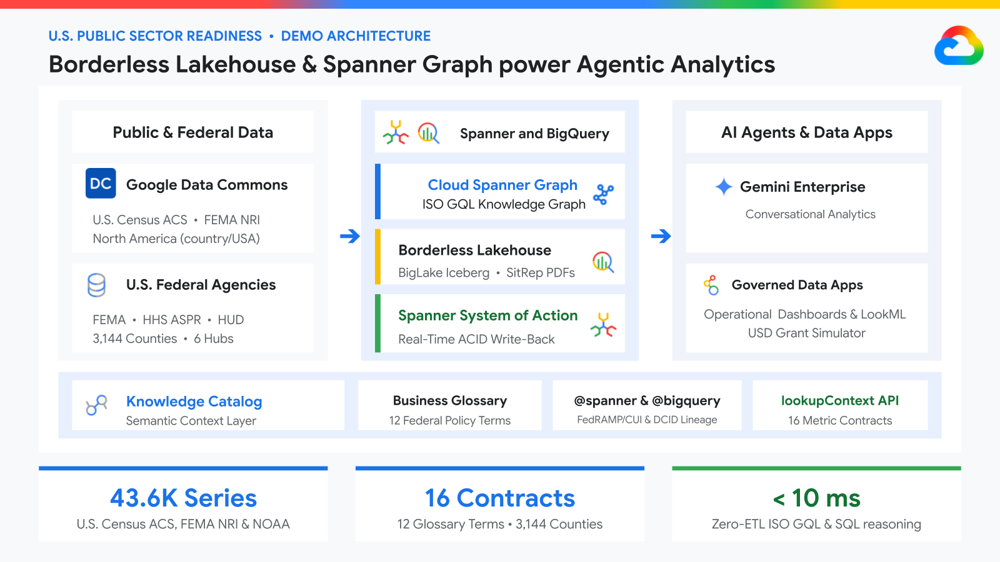

# Project Beacon — Engineering & Architecture Blueprint

**Author:** Sean Zinsmeister | **Audience:** Customer Engineers, Public Sector Architects, AI/Data Developers

---

## Architecture Overview

Project Beacon demonstrates a unified 5-layer **Agentic Data Cloud System of Action** across **3,144 U.S. counties**:

1. **Spanner Graph Operational Core (`DCGraph`):** Stores both public **Google Data Commons** nodes/edges/observations and operational **OpenFEMA** + agency dispatch records inside one GoogleSQL database (`01_data/schema/ddl.sql`). Works identically on Managed Cloud Spanner and local Docker **Spanner Omni**.
2. **BigQuery Borderless Lakehouse (`beacon_disaster_readiness`):** Federates Spanner readiness tables with open **BigLake Managed Apache Iceberg** tables (`noaa_hazard_iceberg`, `fema_field_assessments_iceberg`) and **BigLake Object Tables** (`fema_field_sitrep_objects`) over unstructured FEMA Field SitRep PDFs in Cloud Storage.
3. **Google Cloud Knowledge Catalog:** Enforces 12 statutory federal policy terms (`SVI >= 75.0`, `No Internet >= 18.0%`, `No Vehicle >= 10.0%`), custom `beacon-federal-governance` aspects, and 5-stage column-level lineage.
4. **GEV (Judgment as Expected Value) System-One ADK Agent:** Uses single-token logprob prefill classifiers (`jev_noul` & `jev_choice`) plus `JevGatedMcpToolset` to skip unnecessary 800 ms remote Data Commons MCP handshakes and pre-execute deterministic Spanner queries, cutting end-to-end latency from `~18.0s` to **`3.30s` (5.5x faster)**.
5. **Deterministic Top-of-Card Gemini Playbooks & Looker M3 Data App:** Places verified Altair visualizations at `parts[0]` (`skip_data_result=True`) and enables one-click `$250M` grant simulations and transactional fleet dispatch write-backs in Looker.

## Key Engineering Patterns

- **Top-of-Card Chart Determinism (`05_agents/deploy_gemini_gda_agent.py`):** Setting `options.model = "LATEST_GA_MODEL"` and `exampleQueries = []` ensures the Conversational Analytics planner executes embedded Golden Playbooks and renders charts at `parts[0]` rather than dropping unstyled charts at the bottom.
- **Spanner Omni Dual-Target Connector (`lib/gcp.py` & `05_agents/readiness_agent/db.py`):** Checking `SPANNER_OMNI_ENDPOINT` lets the exact same Python codebase switch between Managed Cloud Spanner and a disconnected Docker Spanner Omni container with zero SQL or GQL changes.
